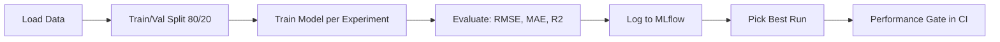

# 🏠 House Price Prediction — MLOps Pipeline


A small end-to-end MLOps project: train a house price model on the California Housing dataset, track every experiment with **MLflow**, and protect the codebase with a **3-layer CI pipeline** (Code, Data, Model) on **GitHub Actions**.

The goal is not just a good model, but a **repeatable, tested workflow** where a bad model or bad data can never reach `main` silently.

---

## 📌 Table of Contents

- [Project Overview](#-project-overview)
- [Project Structure](#-project-structure)
- [Dataset](#-dataset)
- [How the Training Works](#-how-the-training-works)
- [Experiments](#-experiments)
- [Getting Started](#-getting-started)
- [Running Tests](#-running-tests)
- [CI Pipeline](#-ci-pipeline)
- [Key Concepts](#-key-concepts)
- [Possible Improvements](#-possible-improvements)

---

## 🔎 Project Overview

| Item | Details |
|------|---------|
| Task | Regression (predict median house value) |
| Model | `GradientBoostingRegressor` (scikit-learn) |
| Tracking | MLflow (params, metrics, model artifacts) |
| Testing | pytest |
| Linting | flake8 |
| CI/CD | GitHub Actions |



---

## 📁 Project Structure

```
.
├── .github/
│   └── workflows/
│       └── ci.yml            # CI pipeline (lint + code/data/model tests)
├── tests/
│   ├── code_test.py          # Code CI  -> unit test for the split function
│   ├── data_test.py          # Data CI  -> schema + value bounds
│   ├── model_test.py         # Model CI -> performance gate
│   └── README.md             # Details about the tests
├── archive/
│   └── train_old.py          # First version (single script, kept for reference)
├── train.py                  # Main training script (3 functions)
├── requirements.txt          # Python dependencies
└── README.md
```

### `train.py`

The script is split into 3 small functions so each one can be tested on its own:

| Function | Responsibility |
|----------|----------------|
| `load_real_data()` | Loads California Housing and returns `X` (DataFrame) and `y` (target) |
| `split_my_data(x, y)` | Splits 80% train / 20% validation with a fixed `random_state=7` |
| `train_and_evaluate(...)` | Trains one model and returns `model, rmse, mae, r2` |
| `main()` | Orchestrates everything: loops over experiments and logs to MLflow |

> `archive/train_old.py` is the original single-file version. It was refactored into functions in `train.py` so the logic can be imported and tested by pytest.

---

## 📊 Dataset

**California Housing** (loaded with `sklearn.datasets.fetch_california_housing`, downloaded automatically on first run).

| Feature | Meaning |
|---------|---------|
| `MedInc` | Median income in the block |
| `HouseAge` | Median house age |
| `AveRooms` | Average rooms per household |
| `AveBedrms` | Average bedrooms per household |
| `Population` | Block population |
| `AveOccup` | Average household occupancy |
| `Latitude` / `Longitude` | Location of the block |

**Target:** median house value (in units of $100,000).

---

## ⚙️ How the Training Works

1. **Split the data** 80% train / 20% validation.
   The model must be evaluated on data it has never seen. If it trained on everything, the "prediction" would just be memorization, like reading from a database.
2. **Fixed `random_state=7`** so every run uses the *same* split. Otherwise comparing runs is not fair, because each run would see different data.
3. **Train** a `GradientBoostingRegressor` with the hyperparameters of each experiment.
4. **Evaluate** on the validation set:
   - **RMSE** and **MAE** → lower is better
   - **R²** → higher is better
5. **Log** parameters, metrics and the model to MLflow.

---

## 🧪 Experiments

Hyperparameters tried in `train.py`:

| Run | `max_depth` | `learning_rate` |
|-----|-------------|-----------------|
| Run 1 | 3 | 0.1 |
| Run 2 | 5 | 0.05 |
| Run 3 | 7 | 0.01 |

**How were these values chosen?** From known good ranges (depth 3–10, learning rate 0.01–0.3).
In a bigger project you would automate this with `GridSearchCV` / `RandomizedSearchCV`, or a smart optimizer like **Optuna** (Bayesian optimization).

> Why not depth 100 with a tiny learning rate? Because the model would **overfit**: perfect on training data, bad on new data.

The results of each run are saved in MLflow. The **best run (Run 2)** is the one used by the model performance gate in CI.

---

## 🚀 Getting Started

### 1. Clone and create a virtual environment

```bash
git clone https://github.com/<username>/<repo>.git
cd <repo>

python -m venv venv
source venv/bin/activate        # Linux / macOS
venv\Scripts\activate           # Windows
```

### 2. Install dependencies

```bash
pip install -r requirements.txt
```

### 3. Train and log experiments

```bash
python train.py
```

Expected output (values will vary):

```
Run 1 Completed -> RMSE: ..., MAE: ..., R2: ...
Run 2 Completed -> RMSE: ..., MAE: ..., R2: ...
Run 3 Completed -> RMSE: ..., MAE: ..., R2: ...
```

### 4. Open the MLflow UI

```bash
mlflow ui
```

Then open <http://127.0.0.1:5000>, choose the **House_Price_Prediction** experiment, and compare the runs.

---

## ✅ Running Tests

Run everything from the **project root**:

```bash
# all tests
pytest tests/ -v

# one layer only
pytest tests/code_test.py
pytest tests/data_test.py
pytest tests/model_test.py

# linting
flake8 .
```

See [`tests/README.md`](tests/README.md) for what each test checks.

---

## 🔄 CI Pipeline

Defined in [`.github/workflows/ci.yml`](.github/workflows/ci.yml).

### Triggers

| Event | Branches |
|-------|----------|
| `pull_request` | `main` |
| `push` | `main`, `feature/**` |

### Steps

| # | Step | Runs on |
|---|------|---------|
| 1 | Checkout code | always |
| 2 | Setup Python 3.10 | always |
| 3 | Install dependencies | always |
| 4 | Lint with flake8 (fails on syntax errors / undefined names, other issues are warnings) | always |
| 5 | **Code test** (`code_test.py`) | always |
| 6 | **Data test** (`data_test.py`) | push to `main` or any PR to `main` |
| 7 | **Model test** (`model_test.py`) | push to `main` or any PR to `main` |

So a push to a `feature/**` branch only runs the fast checks (lint + code test), while the heavier data and model checks run before anything is merged into `main`.

### The 3 dimensions of CI for ML

| Layer | What it protects | Example here |
|-------|------------------|--------------|
| **Code CI** | Code quality and logic | flake8, split function returns 80/20 |
| **Data CI** | Data quality | All columns exist, no nulls, values make sense |
| **Model CI** | Model quality | RMSE and R² must pass the minimum thresholds |

---

## 💡 Key Concepts

- **Train/validation split**: evaluate on data the model has never seen.
- **`random_state`**: makes the split (and the model) reproducible. Any number works; 42 is just a popular joke from *The Hitchhiker's Guide to the Galaxy*.
- **Overfitting**: the model memorizes the training data instead of learning patterns.
- **Experiment tracking**: MLflow records params + metrics + model for every run, so runs can be compared fairly.
- **Performance gate**: an automatic check that rejects any model worse than the agreed thresholds.

---

## 🔮 Possible Improvements

- Hyperparameter search with `GridSearchCV` or Optuna
- Bias / fairness testing (Model CI), for example error by region
- Cache the dataset in CI to speed up the workflow
- Pin dependency versions in `requirements.txt`
- Model registry and deployment (MLflow Model Registry, then serve via API)